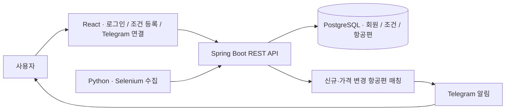

# FlightMore · 항공권 모아

> 여행 조건을 저장하면 수집한 항공편을 비교하고, 조건에 맞는 가격 정보를 Telegram으로 알려주는 프로젝트

**React · Spring Boot · JPA · PostgreSQL · Python · Selenium · Telegram Bot API**

인하공업전문대학 전공심화 SW융합프로젝트 I·II · 2024

## 최종 구현

이 `tof` 브랜치에는 **네이버 로그인, 알림 조건 관리, 항공편 수집·저장, Telegram 연결·해제와 가격 알림**을 포함한 프로젝트의 최종 구현이 있습니다.

| 제가 구현한 부분 | 동작 | 소스 |
| --- | --- | --- |
| **네이버 로그인** | 인증 요청과 콜백을 연결하고, 회원 정보를 조회해 React 화면에 전달 | [로그인 컨트롤러](backend/springboot/src/main/java/com/inhatc/flightmore/presentation/Controller.java) · [React 콜백](react/front/src/NaverRedirectPage.js) |
| **알림 조건 등록·조회·삭제** | 출발지·도착지·여행 기간과 가격 범위를 저장하고, 회원별 목록에서 관리 | [등록 화면](react/front/src/ui/SetNotify.js) · [목록 화면](react/front/src/ui/NotifyList.js) · [REST API](backend/springboot/src/main/java/com/inhatc/flightmore/presentation/NotificationController.java) |
| **항공편 수집과 변경 감지** | Selenium 배치로 항공편을 수집하고, 신규 항공편이나 가격이 바뀐 항공편을 저장해 알림 매칭으로 전달 | [Python 수집 배치](python/naver_flight.py) · [항공편 저장](backend/springboot/src/main/java/com/inhatc/flightmore/application/FlightService.java) |
| **Telegram 연결·해제** | 화면에서 인증코드를 발급하고, 봇이 받은 `AUTH:` 코드로 채팅과 회원을 연결 | [연결 화면](react/front/src/ui/ConnTelegram.js) · [인증코드와 채팅 연결](backend/springboot/src/main/java/com/inhatc/flightmore/application/TelegramIntegrationService.java) · [봇 메시지 처리](backend/springboot/src/main/java/com/inhatc/flightmore/application/TelegramUpdateService.java) |
| **가격 조건 매칭과 알림 발송** | 노선·날짜·가격 조건을 비교하고, 매칭된 항공편을 가격순으로 최대 3개 골라 연결된 채팅으로 메시지 발송 요청 | [매칭과 발송](backend/springboot/src/main/java/com/inhatc/flightmore/application/AlertService.java) |

## 데이터 흐름

## 당시 발표 화면

발표 자료에는 Telegram 연결 완료 메시지와 인천–도쿄 항공권 알림 두 건이 담겨 있습니다. 메시지에는 일정·가격·조회 링크가 함께 표시됩니다.

## 실행 범위

`tof`의 실제 연동 구성은 Java 17, React, PostgreSQL, 네이버 OAuth 및 Telegram 봇 설정을 사용합니다. 비밀값은 서버 환경변수 `NAVER_CLIENT_SECRET`, `SPRING_DATASOURCE_PASSWORD`, `TELEGRAM_BOT_TOKEN`으로 전달합니다.

별도 계정 없이 흐름을 체험하려면 [`master`의 로컬 포트폴리오 데모](https://github.com/withoutsultang/FlightMore/blob/master/README.md)를 실행할 수 있습니다. H2와 샘플 항공편으로 조건 저장·매칭·Telegram 모의 발송을 재현합니다. [45초 데모 영상](https://github.com/withoutsultang/FlightMore/blob/master/docs/flightmore-demo.mp4)
