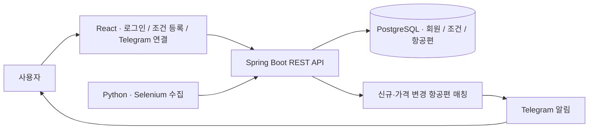

# FlightMore · 항공권 모아

> 여행 조건을 저장하면 수집한 항공편을 비교하고, 조건에 맞는 가격 정보를 Telegram으로 알려주는 프로젝트

**React · Spring Boot · JPA · PostgreSQL · Python · Selenium · Telegram Bot API**

인하공업전문대학 전공심화 SW융합프로젝트 I·II · 2024

## 최종 구현

최종 구현 브랜치인 [`tof`](https://github.com/withoutsultang/FlightMore/tree/tof)에는 **네이버 로그인, 알림 조건 관리, 항공편 수집·저장, Telegram 연결·해제와 가격 알림**을 포함한 프로젝트의 최종 구현이 있습니다.

| 제가 구현한 부분 | 동작 | 소스 |
| --- | --- | --- |
| **네이버 로그인** | 인증 요청과 콜백을 연결하고, 회원 정보를 조회해 React 화면에 전달 | [로그인 컨트롤러](https://github.com/withoutsultang/FlightMore/blob/tof/backend/springboot/src/main/java/com/inhatc/flightmore/presentation/Controller.java) · [React 콜백](https://github.com/withoutsultang/FlightMore/blob/tof/react/front/src/NaverRedirectPage.js) |
| **알림 조건 등록·조회·삭제** | 출발지·도착지·여행 기간과 가격 범위를 저장하고, 회원별 목록에서 관리 | [등록 화면](https://github.com/withoutsultang/FlightMore/blob/tof/react/front/src/ui/SetNotify.js) · [목록 화면](https://github.com/withoutsultang/FlightMore/blob/tof/react/front/src/ui/NotifyList.js) · [REST API](https://github.com/withoutsultang/FlightMore/blob/tof/backend/springboot/src/main/java/com/inhatc/flightmore/presentation/NotificationController.java) |
| **항공편 수집과 변경 감지** | Selenium 배치로 항공편을 수집하고, 신규 항공편이나 가격이 바뀐 항공편을 저장해 알림 매칭으로 전달 | [Python 수집 배치](https://github.com/withoutsultang/FlightMore/blob/tof/python/naver_flight.py) · [항공편 저장](https://github.com/withoutsultang/FlightMore/blob/tof/backend/springboot/src/main/java/com/inhatc/flightmore/application/FlightService.java) |
| **Telegram 연결·해제** | 화면에서 인증코드를 발급하고, 봇이 받은 `AUTH:` 코드로 채팅과 회원을 연결 | [연결 화면](https://github.com/withoutsultang/FlightMore/blob/tof/react/front/src/ui/ConnTelegram.js) · [인증코드와 채팅 연결](https://github.com/withoutsultang/FlightMore/blob/tof/backend/springboot/src/main/java/com/inhatc/flightmore/application/TelegramIntegrationService.java) · [봇 메시지 처리](https://github.com/withoutsultang/FlightMore/blob/tof/backend/springboot/src/main/java/com/inhatc/flightmore/application/TelegramUpdateService.java) |
| **가격 조건 매칭과 알림 발송** | 노선·날짜·가격 조건을 비교하고, 매칭된 항공편을 가격순으로 최대 3개 골라 연결된 채팅으로 메시지 발송 요청 | [매칭과 발송](https://github.com/withoutsultang/FlightMore/blob/tof/backend/springboot/src/main/java/com/inhatc/flightmore/application/AlertService.java) |

## 데이터 흐름



## 당시 발표 화면

발표 자료에는 Telegram 연결 완료 메시지와 인천–도쿄 항공권 알림 두 건이 담겨 있습니다. 메시지에는 일정·가격·조회 링크가 함께 표시됩니다.


## 실행 범위

`tof`의 실제 연동 구성은 Java 17, React, PostgreSQL, 네이버 OAuth 및 Telegram 봇 설정을 사용합니다. 비밀값은 서버 환경변수 `NAVER_CLIENT_SECRET`, `SPRING_DATASOURCE_PASSWORD`, `TELEGRAM_BOT_TOKEN`으로 전달합니다.

## 로컬 포트폴리오 데모 · `master`

**[▶ FlightMore 데모 영상 보기 (MP4)](docs/flightmore-demo.mp4)**

[](docs/flightmore-demo.mp4)

React 화면에서 조건을 등록하고, Spring API가 H2에 조건을 저장한 뒤 샘플 항공권을 SQL로 조회하는 흐름을 담았습니다. 영상에는 최저가 알림 미리보기와 새로고침 후 저장 조건을 다시 불러오는 화면도 나옵니다.

### 직접 실행

**알림 조건 등록 → Spring API 저장 → 샘플 항공권 SQL 조회 → 최저가 알림 미리보기**를 브라우저에서 체험할 수 있습니다. 기본 조건은 인천–도쿄 왕복 2인과 1인 상한가 23만 원입니다. 저장하면 2건이 가격순으로 표시되고, 18만 9천 원 항공편이 미리보기에 들어갑니다.

Java 17과 Node.js를 설치한 뒤 터미널 두 개를 엽니다.

```powershell
# 터미널 1 · 저장소 루트에서 시작
cd backend/springboot
.\gradlew.bat demoBootRun
```

```powershell
# 터미널 2 · 저장소 루트에서 시작
cd react/front
npm ci
$env:REACT_APP_FLIGHTMORE_DEMO = 'true'
$env:HOST = '127.0.0.1'
npm start
```

브라우저에서 `http://127.0.0.1:3000/demo`를 열고 **조건 저장 및 항공권 찾기**를 누릅니다. 상한가를 10만 원으로 바꾸면 매칭 결과가 0건인 경우도 확인할 수 있습니다.

이 데모는 로컬 H2 데이터베이스에 조건을 저장합니다. 서버를 종료하면 세션 데이터가 초기화되며, 샘플 항공편과 알림 미리보기에는 외부 계정이나 API 키가 필요 없습니다.

**Telegram 알림도 재현할 수 있습니다.** 조건을 저장한 뒤 **Telegram 모의 연결 → 최저가 알림 모의 발송**을 누르면, Spring API가 최저가 항공편으로 메시지를 만들어 H2에 저장합니다. 모의 연결 해제와 마지막 메시지 재조회도 가능합니다. 메시지는 데모 화면에 표시됩니다.


| 데모 구성 | 코드 |
| --- | --- |
| React 조건 입력·결과·미리보기 | [Demo.js](react/front/src/demo/Demo.js) |
| 조건 저장·항공편 매칭 API | [DemoAlertController.java](backend/springboot/src/main/java/com/inhatc/flightmore/demo/DemoAlertController.java) |
| 항공편 샘플·API/DB 통합 테스트 | [demo-flights.sql](backend/springboot/src/main/resources/demo-flights.sql) · [DemoAlertIntegrationTest.java](backend/springboot/src/test/java/com/inhatc/flightmore/DemoAlertIntegrationTest.java) |
