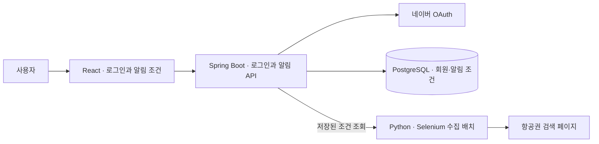

# FlightMore · 항공권 모아

> 출발지·도착지·여행 날짜 조건을 저장하고, 조건에 맞는 항공권 특가를 찾기 위한 웹 프로젝트

**React · Spring Boot · JPA · PostgreSQL · Python · Selenium**

인하공업전문대학 전공심화 SW융합프로젝트 I·II · 2024

## 제가 구현한 부분

| 기능 | 구현 내용 | Git 근거 |
| --- | --- | --- |
| **네이버 로그인** | 인증 요청과 콜백, 토큰 교환, 회원 정보 조회를 Spring Boot와 React 화면에 연결 | [로그인 연동](https://github.com/withoutsultang/FlightMore/commit/65395cd) |
| **개인 알림 설정** | 여행 조건 입력·알림 목록·삭제 화면을 구현하고 Spring REST API와 JPA 저장 모델을 연결 | [알림 기능](https://github.com/withoutsultang/FlightMore/commit/2b2b1d9) |
| **항공권 수집 배치** | 저장된 알림 조건으로 조회 URL을 만들고, Selenium 수집 작업을 병렬로 실행해 결과를 묶어 전송하는 흐름 작성 | [수집 배치](https://github.com/withoutsultang/FlightMore/commit/6f9ab0c) |

최종 발표 자료에는 **조건 알림 목록과 Telegram 연결·항공권 알림 메시지 2건**을 담았습니다. 아래 캡처에서 인천–도쿄 항공권의 일정·가격·조회 링크를 한 메시지에 전달하는 구성을 볼 수 있습니다.


## 구성



## 코드 살펴보기

| 구성 | 위치 |
| --- | --- |
| React 화면 | [로그인 콜백](react/front/src/NaverRedirectPage.js) · [알림 등록](react/front/src/ui/SetNotify.js) · [알림 목록](react/front/src/ui/NotifyList.js) |
| Spring Boot | [로그인](backend/springboot/src/main/java/com/inhatc/flightmore/presentation/Controller.java) · [알림 API](backend/springboot/src/main/java/com/inhatc/flightmore/presentation/NotificationController.java) |
| Python | [네이버 항공권 배치](python/naver_flight.py) · [땡처리 항공권 수집](python/ttang_com.py) |

## 화면 빌드

```bash
cd react/front
npm ci
npm run build
```

Spring Boot 모듈은 Java 17과 Gradle Wrapper를 사용합니다. 로그인과 알림 저장을 연결하려면 PostgreSQL 접속 설정과 네이버 OAuth 앱 설정이 필요합니다.

수집 스크립트의 Python 의존성은 [python/requirements.txt](python/requirements.txt)에 있습니다.
