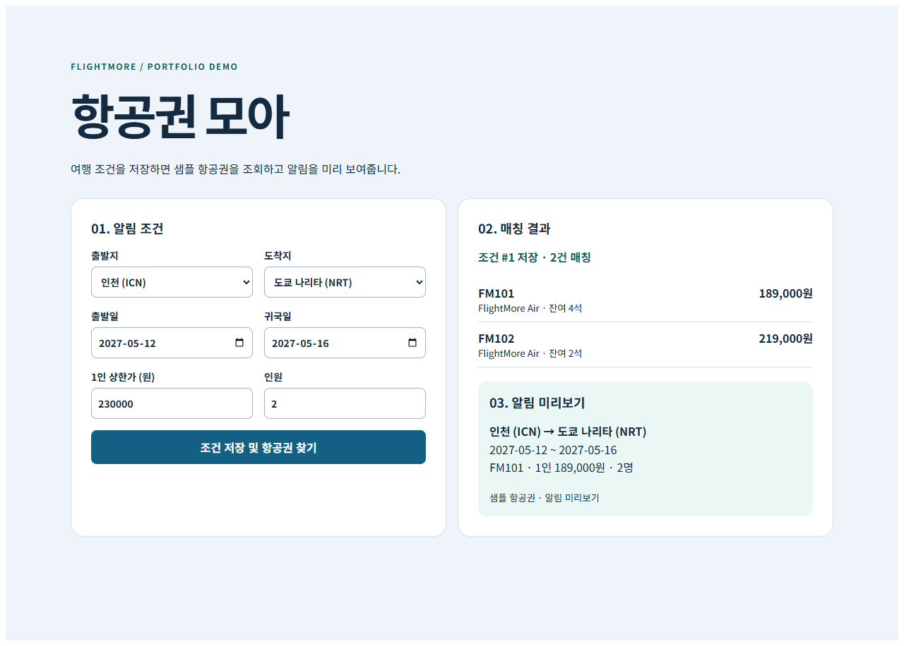
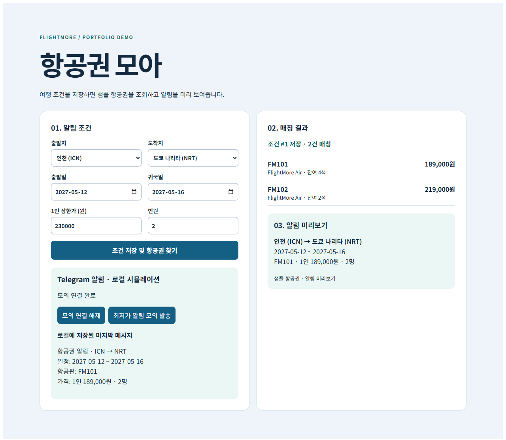
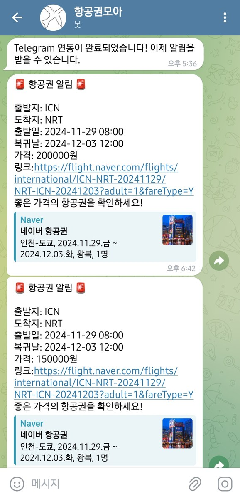
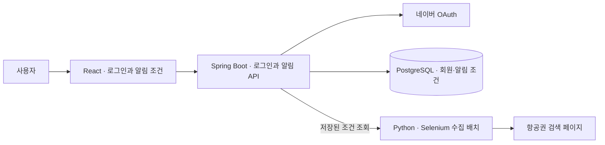

# FlightMore · 항공권 모아

> 출발지·도착지·여행 날짜 조건을 저장하고, 조건에 맞는 항공권 특가를 찾기 위한 웹 프로젝트

**React · Spring Boot · JPA · PostgreSQL · Python · Selenium**

인하공업전문대학 전공심화 SW융합프로젝트 I·II · 2024

**[최종 프로젝트 구현과 README · `tof`](https://github.com/withoutsultang/FlightMore/tree/tof)** — 네이버 로그인, 항공편 수집·저장, Telegram 연결·해제와 가격 알림이 포함된 브랜치입니다. 이 `master` README에는 샘플 데이터로 실행하는 로컬 포트폴리오 데모를 정리했습니다.

## 45초 데모 영상

**[▶ FlightMore 데모 영상 보기 (MP4)](docs/flightmore-demo.mp4)**

[](docs/flightmore-demo.mp4)

React 화면에서 조건을 등록하고, Spring API가 H2에 조건을 저장한 뒤 샘플 항공권을 SQL로 조회하는 흐름을 담았습니다. 영상에는 최저가 알림 미리보기와 새로고침 후 저장 조건을 다시 불러오는 화면도 나옵니다.

## 직접 실행

**알림 조건 등록 → Spring API 저장 → 샘플 항공권 SQL 조회 → 최저가 알림 미리보기**를 브라우저에서 체험할 수 있습니다. 기본 조건은 인천–도쿄 왕복 2인과 1인 상한가 23만 원입니다. 저장하면 2건이 가격순으로 표시되고, 18만 9천 원 항공편이 미리보기에 들어갑니다.

Java 17과 Node.js를 설치한 뒤 터미널 두 개를 엽니다.

```powershell
# 터미널 1 · 저장소 루트에서 시작
cd backend/springboot
.\gradlew.bat demoBootRun
```

```powershell
# 터미널 2 · 저장소 루트에서 시작
cd react/front
npm ci
$env:REACT_APP_FLIGHTMORE_DEMO = 'true'
$env:HOST = '127.0.0.1'
npm start
```

브라우저에서 `http://127.0.0.1:3000/demo`를 열고 **조건 저장 및 항공권 찾기**를 누릅니다. 상한가를 10만 원으로 바꾸면 매칭 결과가 0건인 경우도 확인할 수 있습니다.

이 데모는 로컬 H2 데이터베이스에 조건을 저장합니다. 서버를 종료하면 세션 데이터가 초기화되며, 샘플 항공편과 알림 미리보기에는 외부 계정이나 API 키가 필요 없습니다.

**Telegram 알림도 재현할 수 있습니다.** 조건을 저장한 뒤 **Telegram 모의 연결 → 최저가 알림 모의 발송**을 누르면, Spring API가 최저가 항공편으로 메시지를 만들어 H2에 저장합니다. 모의 연결 해제와 마지막 메시지 재조회도 가능합니다. 메시지는 데모 화면에 표시됩니다.



| 데모 구성 | 코드 |
| --- | --- |
| React 조건 입력·결과·미리보기 | [Demo.js](react/front/src/demo/Demo.js) |
| 조건 저장·항공편 매칭 API | [DemoAlertController.java](backend/springboot/src/main/java/com/inhatc/flightmore/demo/DemoAlertController.java) |
| 항공편 샘플·API/DB 통합 테스트 | [demo-flights.sql](backend/springboot/src/main/resources/demo-flights.sql) · [DemoAlertIntegrationTest.java](backend/springboot/src/test/java/com/inhatc/flightmore/DemoAlertIntegrationTest.java) |

## 제가 구현한 부분

| 기능 | 구현 내용 | Git 근거 |
| --- | --- | --- |
| **네이버 로그인** | 인증 요청과 콜백, 토큰 교환, 회원 정보 조회를 Spring Boot와 React 화면에 연결 | [로그인 연동](https://github.com/withoutsultang/FlightMore/commit/65395cd) |
| **개인 알림 설정** | 여행 조건 입력·알림 목록·삭제 화면을 구현하고 Spring REST API와 JPA 저장 모델을 연결 | [알림 기능](https://github.com/withoutsultang/FlightMore/commit/2b2b1d9) |
| **항공권 수집 배치** | 저장된 알림 조건으로 조회 URL을 만들고, Selenium 수집 작업을 병렬로 실행해 결과를 묶어 전송하는 흐름 작성 | [수집 배치](https://github.com/withoutsultang/FlightMore/commit/6f9ab0c) |
| **Telegram 연동·가격 알림** | 인증코드로 Telegram 채팅을 회원에 연결하고, 저장한 조건에 맞는 항공편을 가격순으로 골라 메시지 발송 요청에 연결 | [최종 매칭·발송 코드](https://github.com/withoutsultang/FlightMore/blob/tof/backend/springboot/src/main/java/com/inhatc/flightmore/application/AlertService.java) |

### Telegram 최종 구현 소스

최종 구현은 `tof` 브랜치에 있습니다. 당시에는 **인증코드 생성 → 봇 메시지에서 코드 확인 → 회원과 채팅 연결 → 조건에 맞는 항공편 발송** 흐름을 구현했습니다.

- [인증코드 발급·채팅 연결·해제](https://github.com/withoutsultang/FlightMore/blob/tof/backend/springboot/src/main/java/com/inhatc/flightmore/application/TelegramIntegrationService.java)
- [봇 메시지 확인과 연결 처리](https://github.com/withoutsultang/FlightMore/blob/tof/backend/springboot/src/main/java/com/inhatc/flightmore/application/TelegramUpdateService.java)
- [항공권 매칭과 Telegram 발송 요청](https://github.com/withoutsultang/FlightMore/blob/tof/backend/springboot/src/main/java/com/inhatc/flightmore/application/AlertService.java)

최종 발표 자료에는 **조건 알림 목록과 Telegram 연결·항공권 알림 메시지 2건**을 담았습니다. 아래 캡처에서 인천–도쿄 항공권의 일정·가격·조회 링크를 한 메시지에 전달하는 구성을 볼 수 있습니다.



## 구성



## 코드 살펴보기

| 구성 | 위치 |
| --- | --- |
| React 화면 | [로그인 콜백](react/front/src/NaverRedirectPage.js) · [알림 등록](react/front/src/ui/SetNotify.js) · [알림 목록](react/front/src/ui/NotifyList.js) |
| Spring Boot | [로그인](backend/springboot/src/main/java/com/inhatc/flightmore/presentation/Controller.java) · [알림 API](backend/springboot/src/main/java/com/inhatc/flightmore/presentation/NotificationController.java) |
| Python | [네이버 항공권 배치](python/naver_flight.py) · [땡처리 항공권 수집](python/ttang_com.py) |

## 화면 빌드

```bash
cd react/front
npm ci
npm run build
```

Spring Boot 모듈은 Java 17과 Gradle Wrapper를 사용합니다. 로그인과 알림 저장을 연결하려면 PostgreSQL 접속 설정과 네이버 OAuth 앱 설정이 필요합니다.

수집 스크립트의 Python 의존성은 [python/requirements.txt](python/requirements.txt)에 있습니다.
